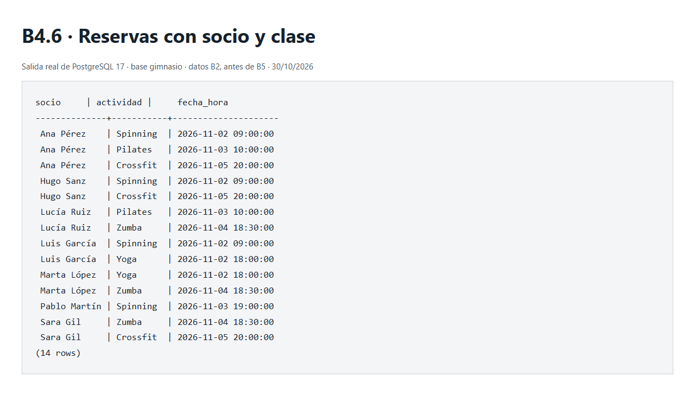

# Ejercicios SQL — Base de Datos Gimnasio FitVal

## Se le ha pedido el formato para el markdown a ChatGPT despues de contestar las preguntas:

## Parte A — Diseño de la base de datos

### Ejercicio A1 — Tipos de claves

**1. ¿Qué columnas no se pueden repetir nunca?**

Las columnas `id`, `dni` y `email`, ya que tienen que ser únicas para cada socio.

**2. ¿Cuál es la clave primaria? ¿Cuáles son las claves alternativas?**

- **Clave primaria (PK):** `id`, sirve para identificar a cada socio.
- **Claves alternativas (UNIQUE):** `dni` y `email`, porque tampoco pueden repetirse.

**3. ¿Qué columna apunta a otra tabla? ¿A cuál?**

La columna `plan_id` es una clave ajena (FK) que apunta al `id` de la tabla `planes`.

**4. ¿Por qué utilizamos un id numérico como clave primaria en vez del DNI?**

Porque es más cómodo trabajar con identificadores numéricos para relacionar las tablas. Además, si tenemos que cambiar el DNI de un socio, su `id` seguiría siendo el mismo.

---

### Ejercicio A2 — Tipos de relaciones

| Pareja                     | Un A, ¿cuántos B?     | Un B, ¿cuántos A? | Relación |
| -------------------------- | --------------------- | ----------------- | -------- |
| Planes – Socios            | Muchos socios         | Un plan           | 1:N      |
| Socios – Tarjetas          | Una como máximo       | Un socio          | 1:1      |
| Monitores – Clases         | Muchas clases         | Un monitor        | 1:N      |
| Socios – Clases            | Muchas clases         | Muchos socios     | N:M      |
| Monitores – Especialidades | Muchas especialidades | Muchos monitores  | N:M      |

---

### Ejercicio A3 — Monitores y clases

**1. Haz las dos preguntas.**

- **¿Cuántas clases puede dar un monitor?** Muchas.
- **¿Cuántos monitores tiene una clase?** Uno.

Por tanto, tenemos una relación **1:N**.

**2. ¿En qué tabla va la clave ajena? ¿Cómo la llamarías?**

La pondría en la tabla `clases` y la llamaría `monitor_id`, ya que es la tabla del lado muchos.

**3. ¿Qué pasaría si la pusiéramos en el lado equivocado?**

Por ejemplo, si añadimos `clase_id` a la tabla `monitores`:

| id  | nombre | clase_id |
| --- | ------ | -------- |
| 1   | Carla  | 1, 4, 7  |
| 2   | Javier | 2, 6     |

Esto estaría mal porque estaríamos guardando varios identificadores en una misma columna. Lo correcto sería poner `monitor_id` en `clases`, así cada clase tendría asignado su monitor.

**4. ¿Debe ser NOT NULL? ¿Por qué?**

Sí, porque según el enunciado todas las clases tienen que tener un monitor asignado.

**5. ¿Qué tabla hay que crear primero?**

Primero `monitores` y después `clases`, porque necesitamos que exista la tabla a la que apunta la clave ajena.

---

### Ejercicio A4 — Relación 1:1

**1. ¿Qué pasaría si quitásemos UNIQUE de socio_id?**

Un mismo socio podría tener varias tarjetas de acceso.

Por ejemplo, podríamos registrar dos tarjetas distintas con `socio_id = 1`, haciendo que la relación pasara de 1:1 a 1:N.

**2. Hay dos columnas UNIQUE en tarjetas. ¿Qué evita cada una?**

- **`codigo UNIQUE`:** evita que dos tarjetas tengan el mismo código.
- **`socio_id UNIQUE`:** evita que un socio tenga más de una tarjeta asignada.

**3. Inventa otra relación 1:1 de la vida real y di dónde pondrías la clave ajena.**

Un ejemplo sería una persona y su pasaporte vigente.

Pondría `persona_id` como clave ajena en la tabla `pasaportes`, con `UNIQUE` para que una persona no pueda tener dos pasaportes vigentes registrados.

---

### Ejercicio A5 — Monitores y especialidades

**1. Haz las dos preguntas y escribe el tipo de relación.**

- **¿Cuántas especialidades puede tener un monitor?** Muchas.
- **¿Cuántos monitores pueden tener una especialidad?** Muchos.

Por tanto, tenemos una relación **N:M**.

**2. ¿Qué tablas necesitas?**

Necesitaríamos estas tres tablas:

- `monitores`
- `especialidades`
- `monitor_especialidades`

La tercera sería la tabla intermedia que relaciona las otras dos.

**3. Escribe las columnas de cada tabla y marca cuál es PK, UNIQUE y FK.**

**Tabla `monitores`:**

| Columna  | Tipo de clave |
| -------- | ------------- |
| `id`     | PRIMARY KEY   |
| `dni`    | UNIQUE        |
| `nombre` | —             |
| `email`  | UNIQUE        |

**Tabla `especialidades`:**

| Columna  | Tipo de clave |
| -------- | ------------- |
| `id`     | PRIMARY KEY   |
| `nombre` | UNIQUE        |

**Tabla `monitor_especialidades`:**

| Columna           | Tipo de clave |
| ----------------- | ------------- |
| `id`              | PRIMARY KEY   |
| `monitor_id`      | FOREIGN KEY   |
| `especialidad_id` | FOREIGN KEY   |

También añadiría la siguiente restricción:

```sql
UNIQUE (monitor_id, especialidad_id)
```

Así evitamos que se repita la misma combinación de monitor y especialidad.

**4. ¿Qué evita el UNIQUE de la tabla intermedia?**

Evita que podamos asignar la misma especialidad dos veces al mismo monitor.

Por ejemplo, que Carla tenga registrada dos veces la especialidad de Yoga.

**5. ¿Qué tienen en común reservas y tu tabla intermedia? ¿En qué se diferencian?**

Las dos son tablas intermedias que utilizan claves ajenas para relacionar otras tablas en una relación N:M.

La diferencia es que `reservas` también guarda `fecha_reserva`, mientras que `monitor_especialidades` solo necesita guardar los identificadores de los monitores y sus especialidades.

---

### Ejercicio A6 — ¿Dónde va la clave ajena?

**1. País – Ciudad**

- **Relación:** 1:N.
- **Explicación:** un país puede tener muchas ciudades, pero cada ciudad pertenece a un país.
- **Clave ajena:** `pais_id` en la tabla `ciudades`.

**2. Persona – Pasaporte**

- **Relación:** 1:1, considerando solamente el pasaporte vigente.
- **Explicación:** una persona puede tener un pasaporte vigente y cada pasaporte pertenece a una persona.
- **Clave ajena:** `persona_id` en la tabla `pasaportes`, con `UNIQUE`.

**3. Alumno – Asignatura**

- **Relación:** N:M.
- **Explicación:** un alumno puede cursar varias asignaturas y una asignatura puede tener muchos alumnos.
- **Tabla intermedia:** `alumno_asignaturas`.

Sus claves ajenas serían:

- `alumno_id`
- `asignatura_id`

**4. Cliente – Pedido**

- **Relación:** 1:N.
- **Explicación:** un cliente puede realizar varios pedidos, pero cada pedido pertenece a un cliente.
- **Clave ajena:** `cliente_id` en la tabla `pedidos`.

**5. Película – Actor**

- **Relación:** N:M.
- **Explicación:** una película puede tener varios actores y un actor puede participar en varias películas.
- **Tabla intermedia:** `pelicula_actores`.

Sus columnas serían:

| Columna       | Descripción                       |
| ------------- | --------------------------------- |
| `pelicula_id` | FK a películas                    |
| `actor_id`    | FK a actores                      |
| `personaje`   | Nombre del personaje interpretado |

El nombre del personaje iría en la tabla intermedia porque depende de la película en la que participa el actor.

**6. Autor – Libro**

Depende de si permitimos que un libro tenga varios autores o solamente uno.

- **Si tiene un solo autor:** relación 1:N, con `autor_id` en `libros`.
- **Si puede tener varios autores:** relación N:M, con una tabla intermedia llamada `autor_libros`.

**7. Furniro: Usuario – Pedido**

- **Relación:** 1:N.
- **Explicación:** un usuario puede hacer varios pedidos, pero cada pedido pertenece a un usuario.
- **Clave ajena:** `usuario_id` en la tabla `pedidos`.

**8. Furniro: Pedido – Producto**

- **Relación:** N:M.
- **Explicación:** un pedido puede incluir varios productos y un producto puede aparecer en diferentes pedidos.
- **Tabla intermedia:** `detalle_pedido`.

Las columnas que utilizaría serían:

| Columna           | Descripción                      |
| ----------------- | -------------------------------- |
| `id`              | Clave primaria                   |
| `pedido_id`       | FK a pedidos                     |
| `producto_id`     | FK a productos                   |
| `cantidad`        | Unidades compradas               |
| `precio_unitario` | Precio del producto al comprarlo |

Con esto podemos guardar los productos de cada pedido, la cantidad y el precio que tenían cuando se compraron.

---

## Parte B — Construcción de la base de datos en PostgreSQL

### Ejercicio B3 — Comprobación de restricciones

En este apartado vamos a comprobar qué pasa cuando intentamos introducir o eliminar datos que no cumplen las restricciones de las tablas.

Primero escribimos lo que creemos que va a pasar y después lo comprobamos ejecutando las consultas en PostgreSQL.

#### B3.1 — Insertar un socio con un plan que no existe

**Predicción:**

Creo que dará error porque el plan con `id = 99` no existe en la tabla `planes`.

La restricción `FOREIGN KEY` de `plan_id` impide que un socio tenga asignado un plan que no existe.

**Error real:**

```text
ERROR:  insert or update on table "socios" violates foreign key constraint "socios_plan_id_fkey"
DETAIL:  Key (plan_id)=(99) is not present in table "planes".
```

**Traducción:** No se puede insertar a Nora porque el plan 99 no existe.

**Restricción:** `socios_plan_id_fkey`: clave ajena de `socios.plan_id` a `planes.id`.

**Integridad:** la operación se ha rechazado y todas las filas siguen iguales.


#### B3.2 — Insertar un socio con el email de Ana

**Predicción:**

Dará error porque `ana@gym.com` ya pertenece a otro socio.

La restricción `UNIQUE` de `email` evita que dos socios tengan el mismo correo.

**Error real:**

```text
ERROR:  duplicate key value violates unique constraint "socios_email_key"
DETAIL:  Key (email)=(ana@gym.com) already exists.
```

**Traducción:** El correo ana@gym.com ya está registrado. No puede pertenecer a dos socios.

**Restricción:** `socios_email_key`: restricción `UNIQUE` de `socios.email`.

**Integridad:** la operación se ha rechazado y todas las filas siguen iguales.


#### B3.3 — Crear una segunda tarjeta para Ana

**Predicción:**

Creo que dará error porque Ana ya tiene una tarjeta asignada.

El `UNIQUE` de `socio_id` impide que podamos asignarle otra.

**Error real:**

```text
ERROR:  duplicate key value violates unique constraint "tarjetas_socio_id_key"
DETAIL:  Key (socio_id)=(1) already exists.
```

**Traducción:** Ana, con socio_id = 1, ya tiene tarjeta. No se le puede asignar otra.

**Restricción:** `tarjetas_socio_id_key`: restricción `UNIQUE` de `tarjetas.socio_id`; mantiene la relación 1:1.

**Integridad:** la operación se ha rechazado y todas las filas siguen iguales.


#### B3.4 — Ana reserva otra vez el Spinning del lunes

**Predicción:**

Dará error porque Ana ya tiene una reserva para esa clase.

La restricción `UNIQUE(socio_id, clase_id)` evita que se repita la misma combinación.

**Error real:**

```text
ERROR:  duplicate key value violates unique constraint "reservas_socio_id_clase_id_key"
DETAIL:  Key (socio_id, clase_id)=(1, 1) already exists.
```

**Traducción:** La pareja socio_id = 1 y clase_id = 1 ya está reservada. Ana no puede reservar esa clase dos veces.

**Restricción:** `reservas_socio_id_clase_id_key`: `UNIQUE (socio_id, clase_id)`.

**Integridad:** la operación se ha rechazado y todas las filas siguen iguales.


#### B3.5 — Crear una reserva para una clase que no existe

**Predicción:**

Creo que dará error porque estamos intentando reservar una clase con `id = 50` que no existe.

La clave ajena `clase_id` no permite guardar reservas de clases que no estén registradas.

**Error real:**

```text
ERROR:  insert or update on table "reservas" violates foreign key constraint "reservas_clase_id_fkey"
DETAIL:  Key (clase_id)=(50) is not present in table "clases".
```

**Traducción:** La clase 50 no existe, así que no se puede guardar una reserva que apunte a ella.

**Restricción:** `reservas_clase_id_fkey`: clave ajena de `reservas.clase_id` a `clases.id`.

**Integridad:** la operación se ha rechazado y todas las filas siguen iguales.


#### B3.6 — Borrar el plan Básico

**Predicción:**

Dará error porque hay socios que tienen contratado ese plan.

La clave ajena `plan_id` de la tabla `socios` impide borrarlo mientras siga teniendo socios asociados.

**Error real:**

```text
ERROR:  update or delete on table "planes" violates foreign key constraint "socios_plan_id_fkey" on table "socios"
DETAIL:  Key (id)=(1) is still referenced from table "socios".
```

**Traducción:** El plan Básico sigue asignado a socios. Borrarlo los dejaría apuntando a un plan inexistente.

**Restricción:** `socios_plan_id_fkey`: clave ajena de `socios.plan_id` a `planes.id`; no hay borrado en cascada.

**Integridad:** la operación se ha rechazado y todas las filas siguen iguales.


#### B3.7 — Borrar el plan Mañanas

**Predicción:**

En este caso debería dejar borrarlo porque no hay ningún socio que tenga contratado ese plan.

**Resultado real:**

```text
BEGIN
 id | nombre  | precio_mensual 
----+---------+----------------
  5 | Mañanas |          19.90
(1 row)

DELETE 1
 planes_mananas_tras_borrar 
----------------------------
                          0
(1 row)

INSERT 0 1
 id |   nombre   | precio_mensual 
----+------------+----------------
  1 | Básico     |          29.90
  2 | Completo   |          44.90
  3 | Estudiante |          24.90
  6 | Mañanas    |          19.90
(4 rows)

COMMIT
```

**Traducción:** `DELETE 1` confirma que se ha borrado Mañanas. La consulta posterior devuelve 0 planes con ese nombre. Después, `INSERT 0 1` confirma que se ha vuelto a insertar.

**Restricción:** no se infringe ninguna clave ajena porque ningún socio tiene contratado Mañanas.

**Integridad:** vuelven a existir los cuatro planes y los demás datos de B2 no han cambiado. Mañanas tenía id 5 y ahora tiene id 6; el nuevo identificador lo genera PostgreSQL.


#### B3.8 — ¿Por qué B3.6 falla y B3.7 funciona?

Porque el plan Básico tiene socios asociados y el plan Mañanas no.

La clave ajena impide borrar Básico porque dejaríamos socios apuntando a un plan que ya no existe, mientras que Mañanas se puede borrar sin afectar a ningún socio.

---


### Ejercicio B4 — Comprobación de las consultas

Las diez consultas están en `gimnasio.sql`. Las he ejecutado antes de B5, con estos resultados:

| Consulta | Resultado real |
| --- | --- |
| B4.1 | 8 socios con su plan y precio. |
| B4.2 | 7 clases con su monitor. |
| B4.3 | 8 socios; Diego aparece con tarjeta NULL. |
| B4.4 | Solo Diego Vidal. |
| B4.5 | Básico: 3; Completo: 3; Estudiante: 2; Mañanas: 0. |
| B4.6 | 14 reservas; Ana aparece 3 veces. |
| B4.7 | Ana Pérez, Hugo Sanz y Luis García. |
| B4.8 | 7 clases; la clase 6 aparece con 0 reservas. |
| B4.9 | Solo Rubén Castro. |
| B4.10 | 7 parejas monitor–especialidad. |

**Captura de B4.6:**



La salida de texto original está en [capturas/b4-6-reservas.txt](capturas/b4-6-reservas.txt). La captura corresponde a los datos anteriores a B5; al repetir la consulta después, cambian las reservas.

---

### Ejercicio B4.11 — ¿Por qué Ana aparece tres veces?

No es un error. Ana aparece tres veces porque tiene tres reservas diferentes y la consulta muestra una fila por cada reserva.

Por eso un mismo socio puede aparecer varias veces si está apuntado a distintas clases.

---

### Ejercicio B5 — Modificar y borrar

Antes de cada `UPDATE` y `DELETE` he consultado las filas con el mismo `WHERE`.

| Apartado | Resultado real | Comprobación |
| --- | --- | --- |
| B5.1 | `UPDATE 1` | Luis tiene ahora el plan Completo (id 2). |
| B5.2 | `UPDATE 1` | La tarjeta TJ-0004 de Hugo está activa. |
| B5.3 | `INSERT 0 1` | Diego tiene la tarjeta activa TJ-0008. |
| B5.4 | `INSERT 0 1` | Diego reserva la clase 6 con fecha 2026-11-02. |
| B5.5 | `DELETE 1` | Desaparece solo la reserva de Luis para la clase 2; conserva la de la clase 1. |
| B5.6 | Error en la baja directa; después, tres `DELETE 1` | Se eliminan la reserva de Pablo, su tarjeta y su ficha, en ese orden. |

**Error real de B5.6:**

```text
ERROR:  update or delete on table "socios" violates foreign key constraint "tarjetas_socio_id_fkey" on table "tarjetas"
DETAIL:  Key (id)=(6) is still referenced from table "tarjetas".
```

**Traducción:** no se puede borrar a Pablo porque todavía tiene una tarjeta que apunta a su id.

**Restricción:** `tarjetas_socio_id_fkey`, clave ajena de `tarjetas.socio_id` a `socios.id`. Pablo también tiene una reserva, así que quitar solo la tarjeta no basta. He borrado primero su reserva y su tarjeta y, por último, al socio, dentro de una transacción. Las tablas hijas deben dejar de apuntar a él antes de borrarlo.

---

### Ejercicio B6 — Explicación de conceptos

**1. ¿Qué diferencia hay entre una clave primaria y una clave UNIQUE?**

La clave primaria identifica cada registro de una tabla y no puede repetirse ni ser `NULL`.

`UNIQUE` también evita que se repitan valores, pero podemos tener varias restricciones `UNIQUE` y estas pueden admitir `NULL` si no añadimos `NOT NULL`.

**2. ¿Por qué una clave ajena sí puede repetirse?**

Porque varios registros pueden estar relacionados con el mismo registro de otra tabla.

Por ejemplo, varios socios pueden tener el mismo `plan_id` porque comparten el mismo plan.

**3. En una relación 1:N, ¿en qué lado va la clave ajena? ¿Por qué no en el otro?**

La clave ajena va en el lado muchos, porque así cada registro guarda un único identificador de la otra tabla.

Si la pusiéramos en el lado uno, tendríamos que guardar varios identificadores en una misma columna.

**4. ¿Qué convierte una relación 1:N en una 1:1?**

Añadir `UNIQUE` a la clave ajena, porque así evitamos que varios registros apunten al mismo.

**5. ¿Por qué una relación N:M necesita una tabla intermedia?**

Porque ambas tablas pueden tener varios registros relacionados entre sí.

Con la tabla intermedia podemos guardar cada relación en una fila mediante dos claves ajenas.

**6. ¿Por qué fecha_reserva está en reservas y no en socios ni en clases?**

Porque la fecha pertenece a una reserva concreta.

Un socio puede reservar varias clases en días diferentes y cada reserva tiene su propia fecha.


---

## Comprobación final — 30 de octubre de 2026

- PostgreSQL 17.11, contenedor `postgres-sql`, base `gimnasio`, usuario `alumno`.
- B3.1–B3.6 rechazadas por las restricciones esperadas, sin cambios en las filas.
- B3.7 borró y repuso Mañanas; antes de B4 se mantenían todos los datos B2.
- B4: ejecutadas las diez consultas y guardado el resultado de B4.6 antes de B5.
- B5: realizados solo los cambios pedidos, sin filas huérfanas.
- Siguen existiendo las ocho tablas.
- El archivo SQL completo se ha validado en un esquema aislado, con aserciones sobre los cambios de B5, y esa prueba se ha revertido con ROLLBACK.

| Tabla | Tras B2 y B3 | Tras B5 |
| --- | ---: | ---: |
| `planes` | 4 | 4 |
| `socios` | 8 | 7 |
| `tarjetas` | 7 | 7 |
| `monitores` | 4 | 4 |
| `clases` | 7 | 7 |
| `reservas` | 14 | 13 |
| `especialidades` | 5 | 5 |
| `monitor_especialidades` | 7 | 7 |

Las diferencias finales son las que pide B5: Pablo se da de baja y se eliminan sus relaciones; Diego obtiene tarjeta y reserva; Luis cancela una reserva. Los ids automáticos pueden tener saltos incluso cuando un INSERT falla: las secuencias no se revierten. No he reiniciado tablas ni secuencias.

`gimnasio.sql` se ejecuta completo sobre un esquema vacío para crear B1, cargar B2, consultar B4 y aplicar B5. Las pruebas intencionadas de B3 y la baja fallida de B5.6 están comentadas para activarlas individualmente en su momento. No se debe ejecutar de nuevo B1/B2 sobre estas tablas ya pobladas. El reto opcional no forma parte de esta entrega.
